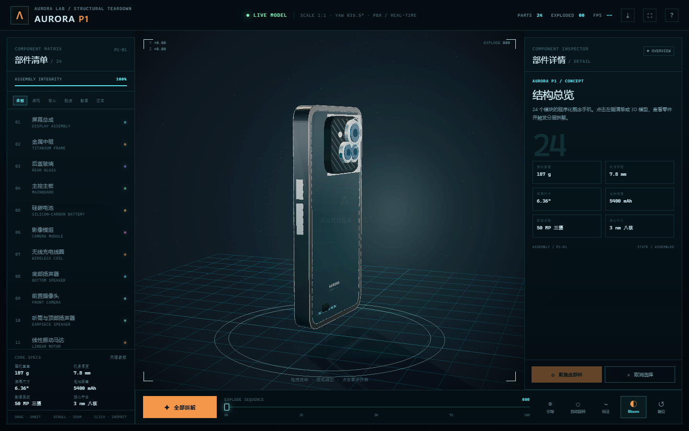

# VeraSplit — 3D 结构拆解实验室

**VeraSplit** 是一个可交互的 3D 结构拆解项目。当前样本 **AURORA P1** 是一台虚构概念手机，24 个零件全部由 Three.js 程序化几何生成，不依赖外部 3D 模型、图片或在线字体。

- 仓库：https://github.com/LishenYuan-work/VeraSplit
- 在线演示：https://lishenyuan-work.github.io/VeraSplit/



## 公网访问

已启用 GitHub Pages，直接访问：

https://lishenyuan-work.github.io/VeraSplit/

拆解态：https://lishenyuan-work.github.io/VeraSplit/?exploded=1

`index.html` 是单文件版，不需要构建，也不需要登录。

## 运行

**最简单：直接双击 `index.html`。**

`index.html` 是单文件成品版：Three.js、Bloom、CSS 和所有代码都已内联，不需要服务器、不需要联网。

如果修改了 `app.js` / `model.js` / `data.js` / `styles.css`，需要重新构建单文件版；开发时可以使用 `index-module.html`：

```bash
python -m http.server 8123 --bind 127.0.0.1
```

然后打开 `http://127.0.0.1:8123/index-module.html`。

Windows 也可以双击 `start.bat`，它会优先用 Python、没有 Python 时用 Node.js（`server.js`）启动开发服务器。

## 交互

| 操作 | 效果 |
|---|---|
| 拖拽 | 环绕旋转 |
| 滚轮 / 双指 | 缩放 |
| 点击零件 / 左侧清单 | 选中并拆解 |
| 双击零件 | 选中并聚焦 |
| 全部拆解 / 组装复位 | 24 个模块分层展开 / 合拢 |
| 拆解滑杆 | 0–100% 手动控制 |
| 引导 | 按顺序拆解和聚焦 24 个零件 |
| Bloom | 开关后处理；低配设备可切到 Fast |
| 自动旋转 | 缓慢展示旋转 |
| 标注 | 显示全部标签；默认只显示选中零件标签 |
| 分类筛选 | 按结构 / 核心 / 能源 / 影像 / 交互筛选零件 |
| 部件（窄屏） | 打开 24 项零件抽屉 |
| 复位 | 回到默认机位与装配状态 |
| `1–9` | 快速选择前 9 个零件 |
| `E` / `R` / `L` / `Space` | 拆解 / 复位 / 标注 / 自动旋转 |
| `B` / `T` / `F` | Bloom 开关 / 导览 / 聚焦 |
| `H` / `?` | 操作指南 |

## 24 个模块

1. 屏幕总成
2. 金属中框
3. 后盖玻璃
4. 主控主板
5. 硅碳电池
6. 影像模组
7. 无线充电线圈
8. 底部扬声器
9. 前置摄像头
10. 听筒与顶部扬声器
11. 线性振动马达
12. 均热板
13. SIM 卡托
14. USB-C 接口
15. 侧边按键
16. 天线模组
17. 顶部麦克风
18. 底部麦克风
19. 环境光与距离传感器
20. 屏幕排线
21. 主板屏蔽罩
22. NFC 天线
23. 石墨散热膜
24. 摄像头支架

## 直接查看某个零件

```text
index.html?exploded=1&part=camera
index.html?exploded=1&tour=1
index.html?exploded=1&parts=1
index.html?exploded=1&labels=1
index.html?exploded=1&filter=optics
index.html?view=back
```

`part` 支持全部 24 个 id：`screen`、`frame`、`back`、`board`、`battery`、`camera`、`coil`、`speaker`、`frontCamera`、`earpiece`、`vibration`、`vapor`、`simTray`、`usb`、`buttons`、`antenna`、`micTop`、`micBottom`、`als`、`displayFlex`、`shield`、`nfc`、`graphite`、`bracket`。

## 引导模式

点击底部「引导」，会从 01 开始自动逐个聚焦 24 个零件；引导条上的 `Ⅱ` / `▶` 暂停或继续，`←` / `→` 手动切换，`×` 退出。每步停留 3.8 秒。

窄屏（≤960px）下，选中零件后 Inspector 会以底部抽屉出现，避免右侧面板被隐藏后看不到参数。

## 导出与全屏

- 顶部 `⤓` 导出当前 3D 画面为 PNG；
- 顶部 `⛶` 切换全屏；
- 系统开启 `prefers-reduced-motion` 时，自动导览默认暂停，仍可手动播放。

## 文件

```text
index.html          单文件成品（双击打开）
index-module.html   开发入口，需要本地服务器
app.js              场景、相机、拆解、拾取、标签、交互
model.js            程序化几何、材质、Canvas 屏幕/PCB/电池纹理
data.js             24 个零件的名称、参数、文案、爆炸方向
styles.css          深色科技视觉、响应式
vendor/three.module.js Three.js r149（MIT，本地）
vendor/addons/       EffectComposer / RenderPass / UnrealBloomPass
preview.png         拆解态截图
start.bat           Windows 本地服务器（Python / Node 自动选择）
server.js           零依赖 Node 静态服务器
```

## 架构

```text
data.js
  └─ 每个零件：id / 名称 / 参数 / 爆炸向量 / 延迟
model.js
  └─ 程序化建模，每个零件一个 Group
app.js
  ├─ explode 进度 0–1
  ├─ 每个零件 position = base + explodeVector × ease(progress)
  ├─ Raycaster 点击拾取
  ├─ 3D 锚点投影到 DOM 标签 + SVG 引线
  └─ 左右 HUD / 底部操作坞
```

## 后续升级

- **加零件**：在 `data.js` 增加数据，在 `model.js` 增加对应 Group；UI 会自动生成。
- **换真实模型**：把 `model.js` 替换成 GLTFLoader 适配层，保留零件 `id` 和爆炸向量即可。
- **加视觉**：已经接入 EffectComposer + UnrealBloomPass；底部的 Bloom 按钮可在低配设备上关闭后处理。后续可继续加描边、景深。
- **嵌入 React / Next.js**：把 `app.js` 的 scene 生命周期放进 `useEffect`，外层 HUD 改成组件。
- **移动端**：已支持部件抽屉和底部 Inspector，可继续做手势与性能分级。

## 打不开时

1. 先直接双击 `index.html`，这是单文件版；
2. 如果浏览器白屏，确认浏览器支持 WebGL 2，并尝试 Edge / Chrome；
3. 如果双击 `index-module.html`，它必须通过 `http://127.0.0.1:8123/` 打开，不能 `file://`；
4. 如果端口被占用，可以运行：

```bash
set PORT=8124
node server.js
```

然后打开 `http://127.0.0.1:8124/index-module.html`。

## 说明

AURORA P1 是虚构概念产品，不对应任何真实厂商。内部结构、比例、参数均为概念化演示，不是维修图。

Three.js 使用 MIT 许可，见 `vendor/THREE-LICENSE.txt`。
